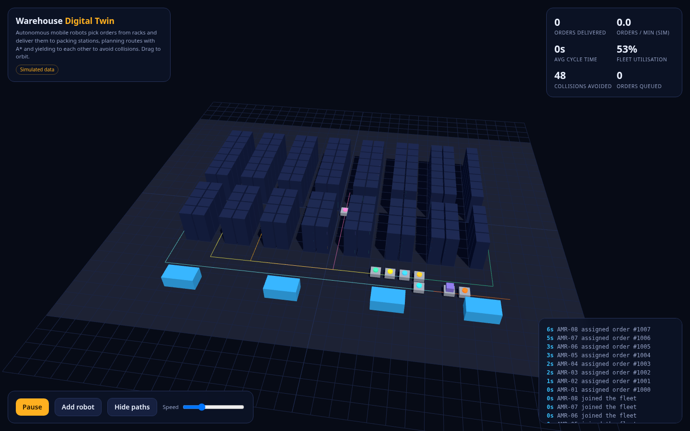

# Warehouse Digital Twin

A three.js 3D digital twin of a warehouse floor. Autonomous mobile robots receive orders, plan routes with A*, pick from racks and deliver to packing stations while yielding to each other to avoid collisions.

**Live:** https://josephbepocode.github.io/warehouse-digital-twin/

## Features
- three.js scene with shadows and orbit controls
- A* pathfinding on a grid with cell reservation
- Live KPIs: deliveries, throughput, cycle time, utilisation, collisions avoided, queue
- Pause, speed, add robots, toggle path overlays

## Notes
All data is simulated in the browser.

## Run locally
It is a static site. Serve the folder with any static server, for example `python3 -m http.server`, and open `http://localhost:8000`.

No backend, no API keys. Built by Deji.
