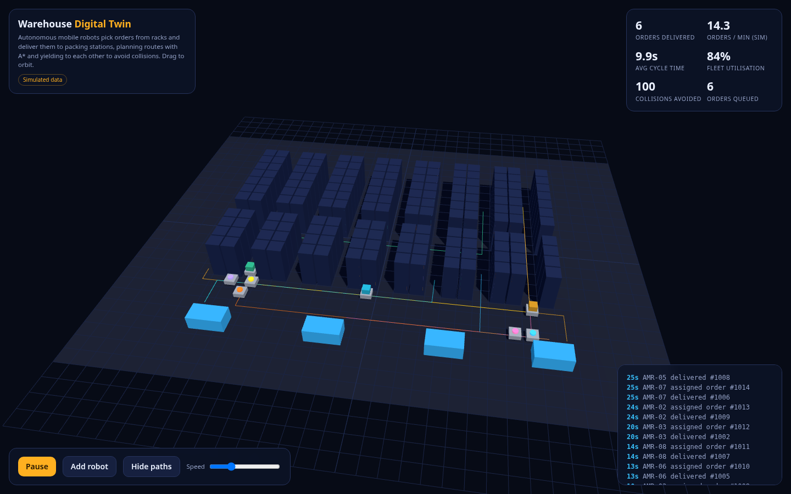

# Warehouse Ops Platform

[](https://github.com/josephbepocode/warehouse-digital-twin/actions/workflows/ci.yml)

The next version of my warehouse digital twin: a warehouse operations platform built in the browser, one milestone a week over five weeks.

**Live demo:** https://josephbepocode.github.io/warehouse-digital-twin/
**Original 3D robot demo (v1):** https://josephbepocode.github.io/warehouse-digital-twin/v1/



## Week 1 (shipped): data model, seeded warehouse, live inventory table

- **Typed data model** (`src/model/types.ts`): zones, bins, docks, SKUs and inventory lots.
- **Seeded fake warehouse** (`src/model/seed.ts`): a seeded random generator builds the same warehouse on every load. With the default seed that is 4 zones (ambient, chilled, freezer, bulk), 16 aisles, 384 bins, 12 dock doors (6 inbound, 6 outbound), 157 SKUs and 348 inventory lots. Products are only stored in a zone that matches their storage type, and no bin is filled past its capacity.
- **Integrity checks** (`src/model/validate.ts`): catches unknown bins or SKUs, duplicate lots, over-capacity bins, wrong storage zones and impossible dates. The tests run it against several seeds.
- **Inventory table**: search across SKU, product, bin, lot and category (every word must match), filter by zone and status, sort by any column, 50 rows per page. Status is worked out from the data: expired, expiring within 7 days, or low stock when a SKU's total cases are below its reorder point.
- **Shareable views**: the search, filters, sort and page are kept in the URL, so a filtered view can be bookmarked or sent, e.g. [`#status=expiring`](https://josephbepocode.github.io/warehouse-digital-twin/#status=expiring).
- **Accessible**: native table with `aria-sort` on headers, labelled controls, a live result count, a skip link, `/` to jump to search, and a card layout on phones with a sort dropdown.

All numbers on the page are computed from the seeded data in your browser. None of it is real company data.

## Roadmap

| Week | Milestone | Status |
| --- | --- | --- |
| 1 | Data model, seeded warehouse, searchable inventory table, tests and CI | Shipped |
| 2 | 2D floor map with animated pick-path routing | Planned |
| 3 | Dock scheduling with drag-to-book slots and conflict checks | Planned |
| 4 | Real-time dashboard (throughput, dwell time, exceptions) from a simulated event stream | Planned |
| 5 | three.js 3D view and a case study page | Planned |

## Stack

TypeScript, Vite, Vitest (with jsdom for UI tests), GitHub Actions, GitHub Pages. No framework, no backend, no API keys.

## Run locally

```bash
npm ci
npm run dev      # local dev server
npm test         # unit + UI tests
npm run build    # type-check and build to dist/
```

Every push to `main` runs type-checking, tests and a build in GitHub Actions, then deploys `dist/` to GitHub Pages.

## Project layout

```
src/model/   data model, seeded generator, queries, validation
src/main.ts  inventory page
tests/       Vitest tests (model + jsdom UI)
public/v1/   the original three.js robot demo, kept as-is
```

Built by Deji.
