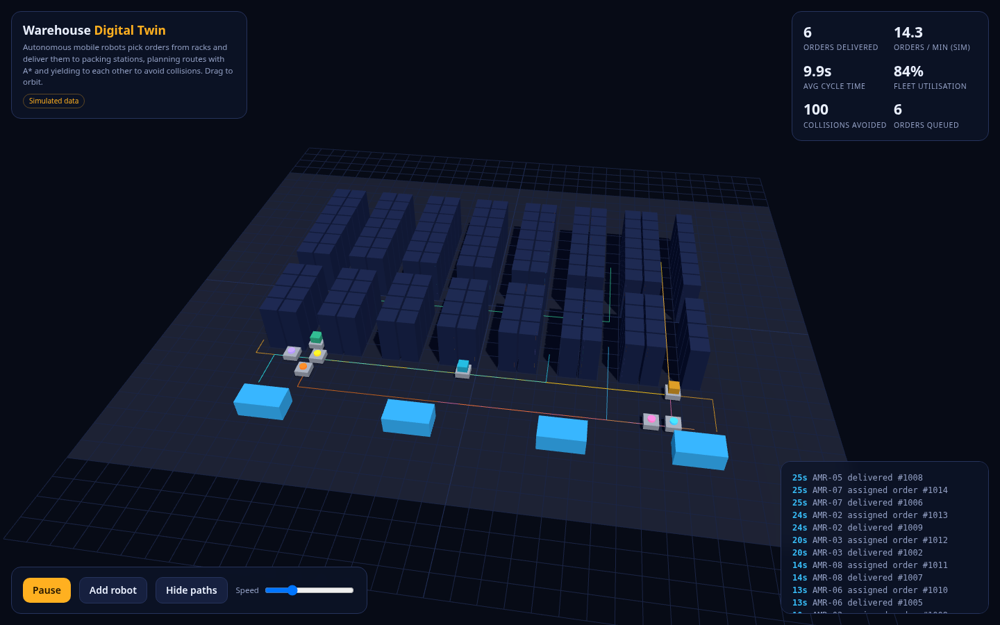

# Warehouse Ops Platform

[](https://github.com/josephbepocode/warehouse-digital-twin/actions/workflows/ci.yml)

The next version of my warehouse digital twin: a warehouse operations platform built in the browser, built one milestone at a time.

**Live demo:** https://josephbepocode.github.io/warehouse-digital-twin/
**Dock schedule (week 3):** https://josephbepocode.github.io/warehouse-digital-twin/docks/
**Original 3D robot demo (v1):** https://josephbepocode.github.io/warehouse-digital-twin/v1/



## Week 1 (shipped): data model, seeded warehouse, live inventory table

- **Typed data model** (`src/model/types.ts`): zones, bins, docks, SKUs and inventory lots.
- **Seeded fake warehouse** (`src/model/seed.ts`): a seeded random generator builds the same warehouse on every load. With the default seed that is 4 zones (ambient, chilled, freezer, bulk), 16 aisles, 384 bins, 12 dock doors (6 inbound, 6 outbound), 157 SKUs and 348 inventory lots. Products are only stored in a zone that matches their storage type, and no bin is filled past its capacity.
- **Integrity checks** (`src/model/validate.ts`): catches unknown bins or SKUs, duplicate lots, over-capacity bins, wrong storage zones and impossible dates. The tests run it against several seeds.
- **Inventory table**: search across SKU, product, bin, lot and category (every word must match), filter by zone and status, sort by any column, 50 rows per page. Status is worked out from the data: expired, expiring within 7 days, or low stock when a SKU's total cases are below its reorder point.
- **Shareable views**: the search, filters, sort and page are kept in the URL, so a filtered view can be bookmarked or sent, e.g. [`#status=expiring`](https://josephbepocode.github.io/warehouse-digital-twin/#status=expiring).
- **Accessible**: native table with `aria-sort` on headers, labelled controls, a live result count, a skip link, `/` to jump to search, and a card layout on phones with a sort dropdown.

All numbers on the page are computed from the seeded data in your browser. None of it is real company data.

## Milestone 3 (shipped): dock scheduling with drag-to-book slots and conflict checks

Live: [`/docks/`](https://josephbepocode.github.io/warehouse-digital-twin/docks/)

- **Day view grid**: the 12 dock doors from the seeded warehouse (6 inbound, 6 outbound) are the rows, and 30-minute slots from 06:00 to 22:00 run across.
- **Drag to book**: drag across an empty row to pick a time, then fill in the carrier and PO or load number. Drag a booking to move it, including to another door, and drag either edge to resize it.
- **Works without a mouse**: every booking is a button. Enter opens it in a form, arrow keys move it by 30 minutes or to the next door, and Shift + arrow keys change its length. A **New booking** form and an **All bookings** list cover keyboard, screen reader and phone use.
- **Conflict checks** (`src/model/schedule.ts`): no overlapping bookings on a door, inbound receipts only on inbound doors and outbound loads only on outbound doors, bookings inside operating hours and on the 30-minute grid, and an optional 15 or 30 minute buffer between bookings. A booking that breaks a rule is not saved, the form shows why next to the fields involved, and a drag that breaks a rule snaps back with the reason.
- **Typed appointment model** (`src/model/types.ts`): door, carrier, inbound or outbound, start and end, PO or load number, trailer and status.
- **Seeded day** (`src/model/docks.ts`): built from the same seed as the warehouse, so it is identical on every load. The default seed gives 42 inbound receipts and 16 outbound loads. Any seed gives 35 to 49 receipts, which is a realistic day at a receiving dock. Carrier names are made up.
- **Saved in your browser**: changes and the buffer setting are kept in localStorage. **Reset to seeded day** puts it back.

## Roadmap

| Week | Milestone | Status |
| --- | --- | --- |
| 1 | Data model, seeded warehouse, searchable inventory table, tests and CI | Shipped |
| 2 | 2D floor map with animated pick-path routing | Planned |
| 3 | Dock scheduling with drag-to-book slots and conflict checks | Shipped 2026-11-18 |
| 4 | Real-time dashboard (throughput, dwell time, exceptions) from a simulated event stream | Planned |
| 5 | three.js 3D view and a case study page | Planned |

## Stack

TypeScript, Vite, Vitest (with jsdom for UI tests), GitHub Actions, GitHub Pages. No framework, no backend, no API keys.

## Run locally

```bash
npm ci
npm run dev      # local dev server
npm test         # unit + UI tests
npm run build    # type-check and build to dist/
```

Every push to `main` runs type-checking, tests and a build in GitHub Actions, then deploys `dist/` to GitHub Pages.

## Project layout

```
src/model/   data model, seeded generator, queries, validation, dock schedule rules
src/main.ts  inventory page
src/docks.ts dock schedule page (docks/index.html)
tests/       Vitest tests (model + jsdom UI)
public/v1/   the original three.js robot demo, kept as-is
```

Built by Deji.
